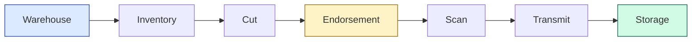

# iBookTrack — Documentation Index

> Welcome. This folder is the complete handover package for **iBookTrack** —
> a unified Warehouse Management System and Executive Dashboard built for
> Innodata's book-digitization pipeline.

---

## 📖 Read in this order

| # | Document | When to read it |
|---|----------|-----------------|
| 1 | **[PROJECT_OVERVIEW.md](./PROJECT_OVERVIEW.md)** | First. Architecture, env setup, and the 8-stage pipeline. |
| 2 | **[architecture/BACKEND.md](./architecture/BACKEND.md)** | When working on the Express API, database schema, or pipeline logic. |
| 3 | **[architecture/FRONTEND.md](./architecture/FRONTEND.md)** | When working on the Next.js UI, scanning stations, or dashboard charts. |
| 4 | **[guides/MIGRATION_GUIDE.md](./guides/MIGRATION_GUIDE.md)** | When deploying to a new server or PostgreSQL instance. |
| 5 | **[TEAM_AND_CREDITS.md](./TEAM_AND_CREDITS.md)** | To see the authors and contributors who built this system. |

---

## 🗺️ At-a-glance

> [!NOTE]
> Every box flows left → right through these stages. Each stage has its
> own UI page in `frontend/app/` and is strictly enforced by the backend API.

---

## 🚀 Quick Start (TL;DR)

1. **Install dependencies**
   - Run `npm install` inside both `backend/` and `frontend/` folders.
2. **Environment**
   - Copy `.env.example` to `.env` at the root and fill in database credentials.
3. **Database Setup**
   - Execute the SQL files in `backend/migrations/` sequentially on your PostgreSQL database.
4. **Start Servers**
   - Terminal 1: `cd backend && npm run dev` (Runs on port 5000)
   - Terminal 2: `cd frontend && npm run dev` (Runs on port 3000)

Detailed steps → [PROJECT_OVERVIEW.md](./PROJECT_OVERVIEW.md).

---

## 🔍 Quick links by topic

<table>
<tr>
  <th>I want to…</th><th>Go to</th>
</tr>
<tr>
  <td>Understand the database schema</td>
  <td><a href="./architecture/BACKEND.md">Backend Architecture</a></td>
</tr>
<tr>
  <td>Understand the UI/UX</td>
  <td><a href="./architecture/FRONTEND.md">Frontend Architecture</a></td>
</tr>
<tr>
  <td>Migrate to a new PostgreSQL server</td>
  <td><a href="./guides/MIGRATION_GUIDE.md">Migration Guide</a></td>
</tr>
<tr>
  <td>See who built this project</td>
  <td><a href="./TEAM_AND_CREDITS.md">Team & Credits</a></td>
</tr>
</table>

> [!TIP]
> A full set of printable, clean PDFs for these documents is available in the **[pdf/](./pdf/)** directory!
