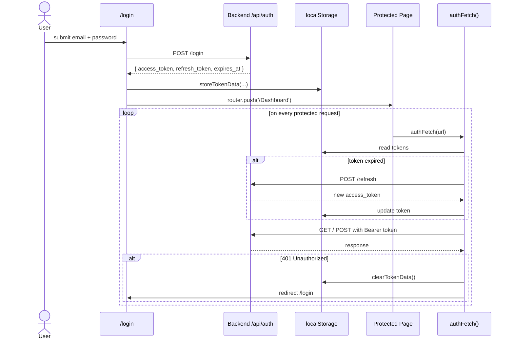

# iBookTrack — Frontend Documentation


Next.js 15 (App Router) + React 19 + TypeScript. Lives in `frontend/`.
Runs on port **3000** by default.

---

## Table of Contents

1. [Tech Stack](#tech-stack)
2. [Directory Layout](#directory-layout)
3. [Routing & Pages](#routing--pages)
4. [Shared Components](#shared-components)
5. [Hooks & Libs](#hooks--libs)
6. [Authentication Flow](#authentication-flow)
7. [Talking to the Backend](#talking-to-the-backend)
8. [Styling](#styling)
9. [State & Data Fetching Patterns](#state--data-fetching-patterns)
10. [Adding a New Page — Recipe](#adding-a-new-page)
11. [Build & Deploy](#build--deploy)

---

## Tech Stack

| Package                       | Version | Purpose                                     |
|-------------------------------|---------|---------------------------------------------|
| `next`                        | ^15.3   | App Router, RSC, image optimization         |
| `react`                       | 19.2    | UI                                          |
| `typescript`                  | 5.7     | Types                                       |
| `tailwindcss`                 | ^4.2    | Utility CSS (v4 — no `tailwind.config.js`)  |
| `@radix-ui/*`                 | latest  | Accessible primitives behind shadcn/ui     |
| `lucide-react`                | ^0.564  | Icon set                                    |
| `sonner`                      | ^1.7    | Toast notifications                         |
| `recharts`                    | 2.15    | Dashboard charts                            |
| `react-hook-form` + `zod`     | latest  | Forms + validation                          |
| `bwip-js`                     | ^4.9    | Barcode rendering for Locator               |
| `next-themes`                 | ^0.4    | Dark/light theme                            |

Scripts:
- `npm run dev` → `next dev` (http://localhost:3000)
- `npm run build` → `next build`
- `npm start` → `next start`
- `npm run lint` → `eslint .`

---

## Directory Layout

```
frontend/
├── app/                          # App Router — folder = route
│   ├── layout.tsx                # root layout (theme provider, sonner)
│   ├── page.tsx                  # redirects to /landing-page
│   ├── globals.css               # Tailwind v4 + design tokens
│   ├── landing-page/             # marketing page sections
│   ├── login/, register/, forgot-password/
│   ├── Dashboard/                # uppercase D directory
│   ├── warehouse/                # legacy single-station scanner
│   ├── warehouse-inventory/      # primary intake + flag UI
│   ├── checkpoints/              # 8-stage send/receive monitor
│   ├── intake/, inventory/
│   ├── qa/                       # Book Inspection & Endorsement
│   ├── transmission/             # transmission monitor
│   ├── locator/                  # warehouse locator + barcodes
│   ├── reports/, settings/, notifications/
├── components/
│   ├── ui/                       # shadcn-generated primitives (button, card, …)
│   ├── dashboard-sidebar.tsx     # global left nav (550+ lines)
│   ├── stats-bar.tsx             # 4-card metrics row
│   ├── transmission-queue.tsx    # live transmission list
│   ├── missing-item-log.tsx      # flagged/non-processable books
│   ├── scanner-input.tsx         # auto-focusing barcode input
│   ├── book-info-card.tsx, intake-summary.tsx, …
│   └── …
├── hooks/
│   ├── use-toast.ts              # wraps sonner
│   └── use-live-notifications.ts # polling notification feed
├── lib/
│   ├── auth-api.ts               # token storage + authFetch wrapper
│   ├── live-notifications.ts     # notification helpers
│   └── utils.ts                  # `cn()` for class merging
├── public/                       # logo, screenshots
└── styles/
```

---

## Routing & Pages

App Router conventions: each folder under `app/` is a route segment, and a
`page.tsx` inside it is the entry component. Loading and error UIs are
standard Next.js conventions when present.

| Route                    | File                                              | Purpose                                              |
|--------------------------|---------------------------------------------------|------------------------------------------------------|
| `/`                      | `app/page.tsx`                                    | `redirect('/landing-page')`                          |
| `/landing-page`          | `app/landing-page/page.tsx`                       | Public marketing site                                |
| `/login`                 | `app/login/page.tsx`                              | Email + password sign-in                             |
| `/register`              | `app/register/page.tsx`                           | New user signup                                      |
| `/forgot-password`       | `app/forgot-password/page.tsx`                    | Password reset email                                 |
| `/Dashboard` ⚠️          | `app/Dashboard/page.tsx`                          | Home — stats, charts, transmission queue, flagged books |
| `/warehouse-inventory`   | `app/warehouse-inventory/page.tsx`                | Primary intake. Scan ISBNs, mark processable/non-processable, flag inline |
| `/warehouse`             | `app/warehouse/page.tsx`                          | Legacy variant; superseded by `/warehouse-inventory` |
| `/intake`                | `app/intake/page.tsx`                             | Pre-warehouse inspection                             |
| `/inventory`             | `app/inventory/page.tsx`                          | Inventory checkpoint                                 |
| `/checkpoints`           | `app/checkpoints/page.tsx`                        | 8-station handshake monitor; advance/rollback boxes  |
| `/qa`                    | `app/qa/page.tsx`                                 | Book Inspection & Endorsement — flag per ISBN with page-no remarks |
| `/transmission`          | `app/transmission/page.tsx`                       | Live transmission feed                               |
| `/locator`               | `app/locator/page.tsx`                            | Find & print box barcode + bin location              |
| `/reports`               | `app/reports/page.tsx`                            | Filterable reports/exports                           |
| `/settings`              | `app/settings/page.tsx`                           | Profile + preferences                                |
| `/notifications`         | `app/notifications/page.tsx`                      | Notification feed                                    |

> [!WARNING]
> **Casing:** `/Dashboard` uses an uppercase `D` while every other route is
> lowercase. Works on Windows/macOS, **breaks on Linux deployments**
> (Vercel, Docker). Rename to `/dashboard` and update 25 references before
> shipping to production.

---

## Shared Components

The big ones — most other components are page-specific and self-explanatory.

### `components/dashboard-sidebar.tsx`
Global left rail. Navigation links, profile dropdown, notifications dropdown.
Uses `useLiveNotifications()` for live counts.

> [!NOTE]
> The previously hard-coded `sampleNotifications` array has already been
> removed during turnover cleanup.

### `components/stats-bar.tsx`
Four-card row across the top of the Dashboard: Active Lots, Boxes In Pipeline,
Books Transmitted Today, Non-Processable / Flagged Books. Last card opens a
modal listing the flagged scans.

### `components/transmission-queue.tsx`
Live transmission feed card. Polled every 20s.

### `components/missing-item-log.tsx`
"Flagged / Non-Processable Books" table on the Dashboard. Fetches
`/api/warehouse/rejected-books?limit=50` and maps each `rejection_reason` via
the `FLAG_LABELS` record (23 keys; see [Project Overview](./PROJECT_OVERVIEW.md)).

### `components/scanner-input.tsx`
Single-line barcode input that auto-focuses, debounces, and fires `onScan(isbn)`
on Enter or after a quiet period. Used on `/warehouse-inventory`, `/locator`,
`/checkpoints`.

### `components/book-info-card.tsx`
Shows the iLMS metadata (title, publisher, language, etc.) for a scanned ISBN.

### `components/ui/*`
shadcn/ui primitives generated via `components.json`. Don't hand-edit unless
you intend to fork them — re-running shadcn would overwrite changes.

---

## Hooks & Libs

### `lib/auth-api.ts` (the most important shared file)

Exports:

| Symbol                      | Purpose                                                  |
|-----------------------------|----------------------------------------------------------|
| `storeTokenData()`          | Save tokens to `localStorage`                            |
| `getTokenData()`            | Read tokens                                              |
| `clearTokenData()`          | Wipe tokens                                              |
| `isTokenExpired()`          | True if `expires_at` < now + 5min buffer                |
| `refreshAccessToken()`      | POST `/api/auth/refresh`, stores new access token        |
| `getValidAccessToken()`     | Refresh if needed, return access token (or null)         |
| `authFetch(url, options)`   | Drop-in `fetch` that injects `Authorization: Bearer …`. Redirects to `/login` on 401. |
| `authRequest({endpoint,…})` | Used by login/register pages.                            |

> Always import `authFetch` for **any** call to a protected backend route.
> Never construct headers manually — you'll forget refresh.

### `hooks/use-toast.ts`
Thin wrapper around `sonner` so the rest of the app uses
`toast({ title, description, variant })`.

### `hooks/use-live-notifications.ts`
Periodic polling for notification badges in the sidebar. Replace with
WebSocket/SSE if you want push behavior.

### `lib/utils.ts`
`cn(...inputs)` — `clsx` + `tailwind-merge` for conditional class names.

---

## Authentication Flow



> [!WARNING]
> Tokens live in `localStorage` and are therefore vulnerable to XSS.
> Acceptable for an internal intranet tool; **migrate to httpOnly cookies
> if you ever expose this app on the public internet.**

The frontend uses custom JWTs for authentication. Tokens are managed by the backend and stored securely.

---


---

## Styling

- **Tailwind v4** — no `tailwind.config.js`. Configuration lives in
  `frontend/postcss.config.mjs` and `app/globals.css` (CSS variables for design
  tokens, `@theme inline` block).
- **Dark mode** via `next-themes`, toggled in the sidebar menu.
- **shadcn/ui** components use semantic tokens (`bg-card`, `text-foreground`,
  `border-input`, etc.). Never reach for raw colors like `bg-gray-200`.

---


---


---

## Build & Deploy

### Local production preview
```powershell
cd frontend
npm run build
npm start
```

### Vercel (recommended)
- Import the repo, set the **Root Directory** to `frontend/`.
- Environment variables (Project Settings → Environment Variables):
  - `NEXT_PUBLIC_API_URL` (the backend's public URL)
- Build command auto-detected (`next build`).

### Static hosting
Not supported — the app uses dynamic routes and server features. Deploy a Node
host or Vercel.

### Common deploy gotchas
- **Linux casing:** rename `app/Dashboard/` → `app/dashboard/` first.
- **CORS:** the backend must list the deployed frontend origin in `FRONTEND_URL`
  or `FRONTEND_URLS`.
- **Mixed content:** if backend is `http://` and frontend is `https://`,
  browsers will block requests. Both must be HTTPS in prod.
