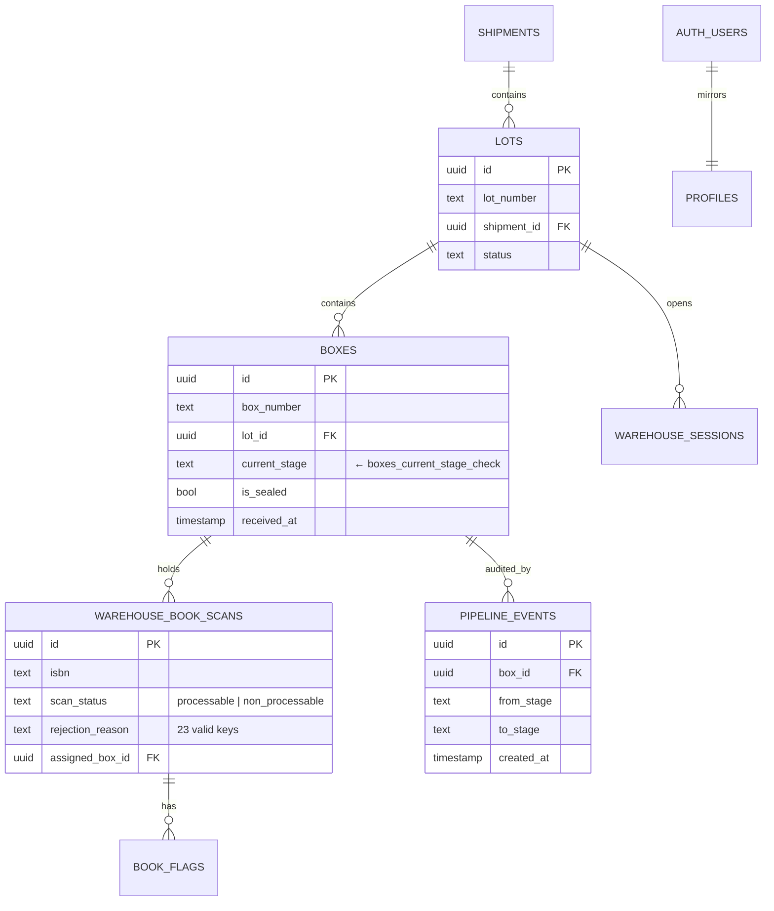

# iBookTrack — Backend Documentation


Express.js API served from `backend/`. Runs on port **5000** by default.

---

## Table of Contents

1. [Tech Stack](#tech-stack)
2. [Directory Layout](#directory-layout)
3. [Boot Sequence](#boot-sequence)
4. [Authentication & Middleware](#authentication--middleware)
5. [API Routes](#api-routes)
6. [Services (External Integrations)](#services-external-integrations)
7. [Database Schema](#database-schema)
8. [Database Constraints](#database-constraints)
9. [Migrations](#migrations)
10. [Background Jobs](#background-jobs)
11. [Error Handling Conventions](#error-handling-conventions)
12. [Adding a New Route — Recipe](#adding-a-new-route)

---

## Tech Stack

| Package                  | Version  | Purpose                                  |
|--------------------------|----------|------------------------------------------|
| `express`                | ^4.21    | HTTP server                              |
| `@supabase/supabase-js`  | ^2.49    | Postgres client + Auth                   |
| `cors`                   | ^2.8     | CORS middleware                          |
| `express-rate-limit`     | ^8.3     | Login / register rate limiting           |
| `dotenv`                 | ^16.4    | Loads `../.env`                          |
| `axios`                  | ^1.14    | HTTP for external APIs                   |
| `mssql`                  | ^12.2    | (legacy direct-DB integration, optional) |
| `xlsx`                   | ^0.18    | Excel parsing for `scanning-excel-reader`|

ES modules everywhere (`"type": "module"` in `package.json`).

Scripts:
- `npm run dev` — `node --watch server.js` (auto-restart on save)
- `npm start` — `node server.js`

---

## Directory Layout

```
backend/
├── server.js                    # entry point + CORS + route registration
├── config/
│   └── supabase.js              # exports { supabase, supabaseAdmin }
├── middleware/
│   └── authMiddleware.js        # requireAuth (Bearer token validator)
├── routes/                      # one file per resource
│   ├── auth.js                  # register / login / logout / refresh / me
│   ├── boxes.js                 # CRUD + advance/rollback/receive
│   ├── books.js                 # ISBN search + flag/unflag
│   ├── lots.js                  # Lot CRUD
│   ├── warehouse.js             # Sessions + scans + rejected-books
│   ├── dashboard.js             # Aggregates for the home dashboard
│   ├── reports.js               # Reports / exports
│   ├── scanning.js              # Read-only Simflex stats
│   ├── storage.js               # Storage locations
│   └── index.js                 # ⚠️  unused, stale doc — see cleanup
├── services/
│   ├── ilms-api.js              # Innodata iLMS HTTP client
│   ├── simflex-api.js           # Simflex HTTP wrapper
│   ├── simflex-db.js            # Higher-level Simflex queries
│   ├── simflex-poller.js        # Polls Simflex every 60s
│   └── scanning-excel-reader.js # Legacy XLSX importer
├── migrations/                  # 25 numbered SQL files + README.md
├── utils/
│   └── testConnection.js        # logs DB connectivity at boot
└── test-warehouse.js            # manual smoke test (delete pre-prod)
```

---

## Boot Sequence

`server.js`:

1. Load `../.env`
2. Build CORS allowlist from `FRONTEND_URL` / `FRONTEND_URLS` + private LAN
3. `app.use(express.json())`
4. Register routers under `/api/<resource>`
5. Health check: `GET /api/health` → `{ status: 'ok', timestamp }`
6. `app.listen(PORT)` then:
   - `testConnection()` — pings Supabase
   - `startSimflexPoller()` — kicks off the 60s polling loop

---

## Authentication & Middleware

### Supabase clients (`config/supabase.js`)

- `supabase` — anon key, used for **login / register / `auth.getUser`**.
- `supabaseAdmin` — service-role key, **bypasses RLS**, used for any
  warehouse/inventory mutation. Never imported into frontend code.

### `requireAuth` (`middleware/authMiddleware.js`)

Reads `Authorization: Bearer <jwt>`, validates with `supabase.auth.getUser`, and
attaches `req.user` (Supabase user object including `user_metadata`).

```js
import { requireAuth } from '../middleware/authMiddleware.js'
router.get('/protected', requireAuth, (req, res) => {
  // req.user.id, req.user.email, req.user.user_metadata.full_name
})
```

Returns `401` on missing/invalid token. The frontend's `authFetch` automatically
redirects to `/login` on 401.

---

## API Routes

All routes are JSON in / JSON out. Errors return `{ error: string }` with an
appropriate 4xx/5xx code.

### `/api/auth` (`routes/auth.js`)

| Method | Path        | Auth | Body                              | Notes                                      |
|--------|-------------|------|-----------------------------------|--------------------------------------------|
| POST   | `/register` | -    | `{ name, email, password }`       | Rate-limited 5/hr/IP. Creates `profiles` row. |
| POST   | `/login`    | -    | `{ email, password }`             | Rate-limited 10/15min/IP. Returns tokens.  |
| POST   | `/refresh`  | -    | `{ refresh_token }`               | Returns new `access_token` + `expires_at`. |
| POST   | `/logout`   | ✅   | -                                 | Revokes session.                           |
| GET    | `/me`       | ✅   | -                                 | Echoes profile + user.                     |

### `/api/boxes` (`routes/boxes.js`)

| Method | Path                              | Auth | Description                                              |
|--------|-----------------------------------|------|----------------------------------------------------------|
| GET    | `/`                               | ✅   | List boxes. Filters: `lot_id`, `current_stage`, `box_number`. Includes scan count. |
| GET    | `/:id`                            | ✅   | Single box + all `warehouse_book_scans` joined.          |
| GET    | `/lot/:lot_number`                | -    | Boxes for a lot.                                          |
| GET    | `/stats/pipeline`                 | ✅   | Counts per `current_stage` (optional `lot_number` filter).|
| GET    | `/pipeline-transitions`           | ✅   | Recent `pipeline_events` (limit param).                  |
| POST   | `/`                               | ✅   | Create box.                                               |
| PUT    | `/:id`                            | ✅   | Update stage / counts. Auto-logs `pipeline_events` on stage change. |
| POST   | `/:id/receive`                    | ✅   | Mark received at the current stage (sets `received_at`). |
| POST   | `/:id/advance`                    | ✅   | Advance to next stage (`STAGE_ORDER` list). Logs event.  |
| POST   | `/:id/rollback`                   | ✅   | Body `{ to_stage }`. Reverts and logs.                   |

`STAGE_ORDER = ['warehouse','inventory','cut','endorsement','scan','transmit','storage']`

### `/api/books` (`routes/books.js`)

| Method | Path             | Auth | Description                                              |
|--------|------------------|------|----------------------------------------------------------|
| GET    | `/`              | ✅   | List books with filters.                                  |
| GET    | `/isbn/:isbn`    | ✅   | Lookup by ISBN.                                           |
| GET    | `/ilms/search/:isbn` | -| Proxy to iLMS for live metadata.                          |
| GET    | `/flags`         | ✅   | Bulk-fetch flags. Query: `scan_ids=id1,id2,…`            |
| POST   | `/`              | ✅   | Create book record.                                       |
| POST   | `/:id/flag`      | ✅   | Body `{ issue, remarks, box_id }`. Records QA flag.      |
| PUT    | `/:id`           | ✅   | Update.                                                   |
| POST   | `/:id/transmit`  | ✅   | Mark transmitted.                                         |
| POST   | `/:id/unaccounted` | ✅ | Mark missing.                                             |
| POST   | `/scan`          | ✅   | Inventory-gate scan log.                                  |

### `/api/lots` (`routes/lots.js`)

CRUD for `lots` plus `GET /:lot_number` lookup.

### `/api/warehouse` (`routes/warehouse.js`)

| Method | Path                                  | Description                                      |
|--------|---------------------------------------|--------------------------------------------------|
| POST   | `/sessions/start`                     | Begin a receiving session for a lot.             |
| POST   | `/sessions/:session_id/scan`          | Save one scan. Body: `{ isbn, scan_status, rejection_reason?, notes? }`. Auto-creates a box on first scan. |
| GET    | `/sessions/:session_id`               | Session + all scans.                              |
| POST   | `/sessions/:session_id/complete`      | Close session.                                   |
| GET    | `/sessions`                           | List sessions.                                   |
| GET    | `/search/isbn/:isbn`                  | Find which box holds an ISBN.                    |
| GET    | `/rejected-books`                     | Non-processable scans (`limit` param). Joins box → lot. |
| PATCH  | `/scans/:scan_id/flag`                | Re-flag an existing scan.                        |
| POST   | `/backfill-titles`                    | Maintenance: refill `title` field via iLMS.      |

`scan_status` ∈ `{ 'processable', 'non_processable' }`. `rejection_reason` is
one of the 23 canonical flag keys (see [Project Overview §6](./PROJECT_OVERVIEW.md#known-loopholes--cleanup-checklist-pre-turnover)).

### `/api/dashboard` (`routes/dashboard.js`)

Aggregate endpoints powering the home dashboard cards/charts:
`/stats`, `/transmission-queue`, `/unaccounted-books`, `/pipeline-stats`,
`/scan-history`. All accept optional `lot_number` filtering.

### `/api/scanning` (`routes/scanning.js`)

Read-only proxy over Simflex. See [Services](#services-external-integrations).

| GET | `/summary`     | Today's totals.                |
| GET | `/by-machine`  | Per-machine breakdown.         |
| GET | `/by-stage`    | Stage breakdown.                |
| GET | `/data`        | Range query (`startDate`,`endDate`). |
| GET | `/live`        | Combined snapshot.              |

### `/api/reports` (`routes/reports.js`)

Composable report generators backing the Reports page.

### `/api/storage` (`routes/storage.js`)

Locations CRUD for the warehouse locator.

---

## Services (External Integrations)

### Simflex WMS (`services/simflex-*.js`)

- **Transport:** HTTPS to
  `https://simflex.innodata.com/wms.services/WMS.Services.asmx/TechGetDatabaseDataset`
- **Auth:** API key + config code passed as query params.
- **Config:** read from `.env` (`SIMFLEX_API_URL`, `SIMFLEX_API_KEY`,
  `SIMFLEX_CONFIG`). The poller logs a warning if any are missing.
- **Polling:** `simflex-poller.js` runs every 60s on boot, caches the latest
  summary used by `/api/scanning/live` and the dashboard live tiles.

### iLMS (`services/ilms-api.js`)

Looks up book metadata by ISBN. Used at warehouse-inventory scan time so the
scanner sees the title immediately.

### Excel reader (`services/scanning-excel-reader.js`)

Legacy bulk import of scan logs from XLSX. Kept for one-off recoveries; safe
to remove once you confirm nobody runs it.

---

## Database Schema

### Hierarchy



Cross-cutting tables:

- `profiles` — mirrors `auth.users`, holds `name`, `email`, `role`,
  `profile_picture` URL.
- `pipeline_events` — append-only audit log for every stage change.
- `warehouse_sessions` — open scanning sessions; FK → `lots`, `boxes`.
- `transmission_queue` — progress rows surfaced on the dashboard.
- `unaccounted_books` — flagged-as-missing rows per stage.
- `scan_history` — inventory-gate scan log.
- `storage_locations` — the locator grid.
- `staging_*` — temporary import targets (Indic comparisons, etc.).

Detailed column lists are in each migration file under `backend/migrations/`.

---

## Database Constraints

These are the "land mines" we hit during dev. Document them when you change
stages or flag values.

### `boxes_current_stage_check`

Allowed values:
```
warehouse, inventory, cut, endorsement, scan, transmit, storage, intake
```

> [!CAUTION]
> **To change this constraint, ALWAYS go in this exact order:**
> 1. `ALTER TABLE boxes DROP CONSTRAINT boxes_current_stage_check;`
> 2. `UPDATE boxes SET current_stage = '<new>' WHERE current_stage IN ('<legacy>', …);`
> 3. `ALTER TABLE boxes ADD CONSTRAINT boxes_current_stage_check CHECK (current_stage IN (…));`
>
> Doing the ADD before the UPDATE will fail because existing rows still hold
> the old value. This has bricked dev DBs more than once during turnover.

### `warehouse_book_scans.scan_status`

Allowed values: `processable`, `non_processable`. (Old data may contain
`accepted`, `rejected` — migrated in early 2026.)

### `warehouse_book_scans.rejection_reason`

23 valid keys (21 modern + 2 legacy). Source of truth lives in the frontend
`FLAG_ISSUES` array; keep both in sync. Listed in
[`PROJECT_OVERVIEW.md`](./PROJECT_OVERVIEW.md#cleaning-legacy-non-processable-scans-data-migration-leftover).

### Row-Level Security

Every public table has RLS enabled. Anonymous and authenticated users have
read-only or row-scoped access; admins via service-role bypass everything.
See migrations `002`, `011`, `013`, `019`.

---

## Migrations

Files `001` through `025` (note `020` is intentionally absent — numbering gap,
not a missing migration). Run in order on a fresh DB.

Critical ones:
- `005_create_boxes_table.sql` — defines `current_stage` enum
- `012_create_warehouse_operations.sql` — sessions + scans
- `014_add_box_capacity_and_sealing.sql` — `is_sealed`, capacity per box
- `024_fix_pipeline_events_constraint.sql` — adds `endorsement` to allowed events
- `025_optimize_lot_stats.sql` — `get_lot_stats()` RPC used by dashboard

---

## Background Jobs

- **Simflex poller** — `services/simflex-poller.js`, started in `server.js`.
  60s interval. Caches the last successful payload and exposes it through
  `/api/scanning/live`.

There are no other cron jobs. Anything time-based should live here.

---

## Error Handling Conventions

```js
router.post('/something', requireAuth, async (req, res) => {
  try {
    if (!req.body.foo) return res.status(400).json({ error: 'foo is required' })
    const { data, error } = await supabaseAdmin.from('table').insert(...).select().single()
    if (error) throw error
    if (!data) return res.status(404).json({ error: 'Not found' })
    res.json({ success: true, data })
  } catch (err) {
    console.error('Something failed:', err)
    res.status(500).json({ error: err.message })
  }
})
```

> [!IMPORTANT]
> Always destructure `{ data, error }` from Supabase calls and **check `error`**.
> Silently dropping the error (we did this once with `createBoxIfNeeded`) made
> a 500 almost impossible to debug. The fix added `if (error) throw error` plus
> a clear `console.error` prefix.

- Log with `console.error('<scope>:', err)` so the prefix is grep-able.
- Never trust `req.body` — validate fields you read.

---

## Adding a New Route

1. Create `backend/routes/foo.js`:
   ```js
   import express from 'express'
   import { supabaseAdmin } from '../config/supabase.js'
   import { requireAuth } from '../middleware/authMiddleware.js'

   const router = express.Router()

   router.get('/', requireAuth, async (req, res) => { /* … */ })

   export default router
   ```
2. Register in `server.js`:
   ```js
   import fooRoutes from './routes/foo.js'
   app.use('/api/foo', fooRoutes)
   ```
3. If the route mutates a table, ensure RLS allows the JWT user **or** use
   `supabaseAdmin` and enforce permissions in code.
4. Add an entry to this file under [API Routes](#api-routes).

---

## Quick Reference — Useful SQL

```sql
-- Promote an admin
UPDATE profiles SET role = 'admin' WHERE email = 'you@innodata.com';

-- Active boxes per stage
SELECT current_stage, COUNT(*) FROM boxes GROUP BY current_stage ORDER BY 1;

-- Recent pipeline movements
SELECT moved_by_name, from_stage, to_stage, created_at
FROM pipeline_events ORDER BY created_at DESC LIMIT 50;

-- Today's flagged books
SELECT isbn, rejection_reason, scanned_by_name, scanned_at
FROM warehouse_book_scans
WHERE scan_status = 'non_processable'
  AND scanned_at >= CURRENT_DATE
ORDER BY scanned_at DESC;
```
