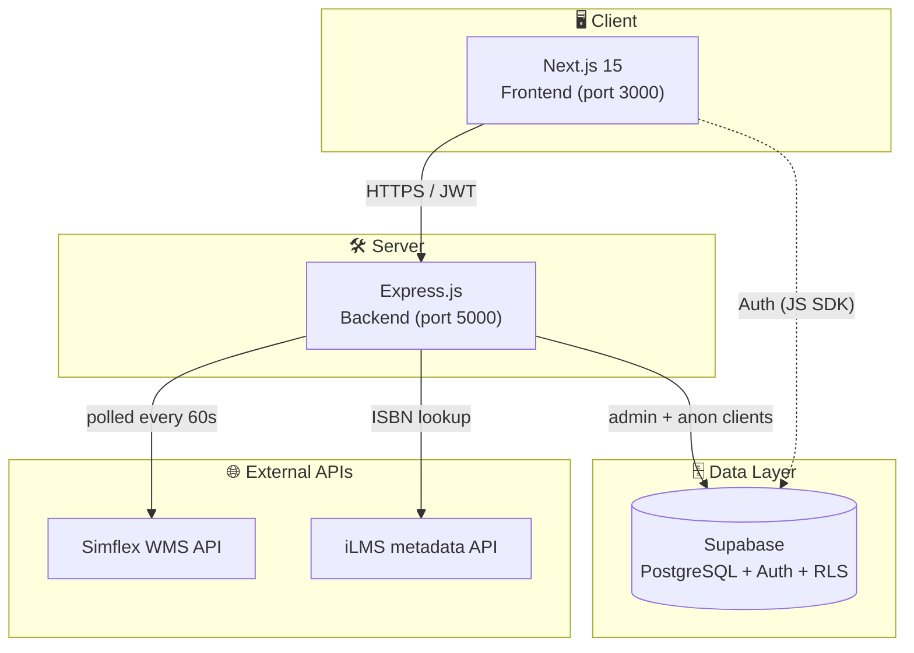

# iBookTrack — Project Overview & Turnover Guide


> A unified Warehouse Management System (WMS) and Executive Dashboard for Innodata's
> physical book digitization workflow. Tracks every book through an 8-stage pipeline
> from arrival (Warehouse) to final Storage, eliminating inventory loss and replacing
> Excel-based logs.

> [!IMPORTANT]
> This is the **single source of truth** for anyone taking over the project.
> Read this file end-to-end before touching code.

Deeper technical detail:

- [`FRONTEND.md`](./FRONTEND.md) — every page, component, hook
- [`BACKEND.md`](./BACKEND.md) — every route, service, schema
- [`MIGRATION_GUIDE.md`](./MIGRATION_GUIDE.md) — moving to a new server / database / hosting

---

## 1. High-Level Architecture



**Key tech choices:**

- **Frontend:** Next.js 15 (App Router), React 19, TypeScript, Tailwind CSS v4,
  shadcn/ui (Radix), lucide-react icons, sonner toasts.
- **Backend:** Node.js + Express 4 (ES modules), `@supabase/supabase-js`, axios,
  express-rate-limit. No ORM — Supabase JS client is used directly.
- **Database:** Supabase Postgres with RLS. Migrations are plain SQL in
  `backend/migrations/`.
- **Auth:** Supabase Auth (email + password). Frontend stores `access_token`,
  `refresh_token`, `expires_at` in `localStorage`. Backend validates via
  `requireAuth` middleware.
- **External integrations:**
  - **Simflex WMS** (read-only, scan/validation/PDF data) via `services/simflex-*.js`
  - **iLMS** (book metadata lookup by ISBN) via `services/ilms-api.js`

---

## 2. The 8-Stage Pipeline

Every box advances through these stages in order. Each stage has a UI page and a
corresponding `current_stage` value in the `boxes` table.

| # | Stage         | UI Page                       | Action at this stage                                         |
|---|---------------|-------------------------------|--------------------------------------------------------------|
| 1 | `warehouse`   | `/warehouse-inventory`        | Receive box, scan all books, flag non-processable inline    |
| 2 | `inventory`   | `/checkpoints`                | Inventory acceptance handshake                              |
| 3 | `cut`         | `/checkpoints`                | Cutting station handshake                                    |
| 4 | `endorsement` | `/qa`                         | Inspect every ISBN, attach issue + page-no remarks          |
| 5 | `scan`        | `/checkpoints`                | Hand off to scanning station (Simflex takes over)           |
| 6 | `transmit`    | `/transmission`, `/checkpoints` | Live transmission monitor, hash-check                      |
| 7 | `storage`     | `/locator`                    | Final box location lookup                                    |

`/checkpoints` is the global "send / receive" handshake page. Boxes only move
forward when they are received at the next station — preventing book loss.

> [!CAUTION]
> Allowed values for `boxes.current_stage` are constrained at the DB level by
> `boxes_current_stage_check`. See [`BACKEND.md` → Database Constraints](./BACKEND.md#database-constraints)
> **before** adding stages — the wrong order of `ALTER TABLE` statements has
> bricked dev DBs more than once.

---

## 3. Repository Layout

```
iBookTrack/
├── .env                       # secrets (NEVER commit)
├── .env.example               # template
├── README.md                  # short marketing readme
├── docs/
│   ├── PROJECT_OVERVIEW.md   # ← you are here
│   ├── FRONTEND.md
│   ├── BACKEND.md
│   └── MIGRATION_GUIDE.md
├── frontend/                  # Next.js app
│   ├── app/                   # App Router pages
│   ├── components/            # Shared UI (incl. /ui shadcn primitives)
│   ├── hooks/
│   ├── lib/                   # auth-api.ts, utils.ts, live-notifications.ts
│   └── package.json
└── backend/                   # Express API
    ├── server.js              # entry point
    ├── config/supabase.js     # Supabase clients
    ├── middleware/             # requireAuth
    ├── routes/                # auth, boxes, books, lots, warehouse, dashboard, …
    ├── services/              # simflex-*, ilms-api
    ├── migrations/            # 001..025 SQL files
    └── package.json
```

---

## 4. Local Development — From Zero

### Prerequisites
- Node.js **v20 LTS or newer** (`node -v`)
- npm or pnpm
- A Supabase project (free tier is fine for dev)
- Network access to `simflex.innodata.com` if you need live scanning data
  (otherwise the poller will log warnings, app still works)

### One-time setup

1. **Clone & install**

   ```powershell
   git clone <repo-url> iBookTrack
   cd iBookTrack

   # Backend deps
   cd backend
   npm install

   # Frontend deps
   cd ../frontend
   npm install
   ```

2. **Create `.env` at the repo root** (used by both frontend and backend):

   ```env
   # Supabase (Settings → API in dashboard)
   NEXT_PUBLIC_SUPABASE_URL=https://xxxxx.supabase.co
   NEXT_PUBLIC_SUPABASE_ANON_KEY=eyJhbGc...
   SUPABASE_SERVICE_ROLE_KEY=eyJhbGc...     # server-only, bypasses RLS

   # Backend
   PORT=5000
   FRONTEND_URL=http://localhost:3000
   # FRONTEND_URLS=http://localhost:3000,http://192.168.1.50:3000   # optional list

   # Frontend → Backend
   NEXT_PUBLIC_API_URL=http://localhost:5000
   ```

   `frontend/.env.local` is also accepted by Next.js if you prefer to split.

3. **Run the database migrations** (one time, in Supabase SQL Editor):
   - Go to Supabase → SQL Editor
   - Open each file in `backend/migrations/` **in numeric order** (001 → 025)
   - Paste and run each one
   - See `backend/migrations/README.md` for table-by-table descriptions

4. **Start both servers** (two terminals):

   ```powershell
   # Terminal 1
   cd backend
   npm run dev          # node --watch, restarts on change

   # Terminal 2
   cd frontend
   npm run dev          # http://localhost:3000
   ```

5. **Register a user** at `http://localhost:3000/register`. The first user is
   plain `user` role; promote to admin in Supabase manually if needed.

---

## 5. Environment Variables Reference

| Variable                          | Where used         | Required | Purpose                                       |
|-----------------------------------|--------------------|----------|-----------------------------------------------|
| `NEXT_PUBLIC_SUPABASE_URL`        | both               | ✅        | Supabase project URL                          |
| `NEXT_PUBLIC_SUPABASE_ANON_KEY`   | both               | ✅        | Public anon key (safe in browser)             |
| `SUPABASE_SERVICE_ROLE_KEY`       | backend only       | ✅        | Bypasses RLS — **never** expose to browser    |
| `PORT`                            | backend            | optional | Default 5000                                  |
| `FRONTEND_URL`                    | backend            | optional | Single allowed CORS origin                    |
| `FRONTEND_URLS`                   | backend            | optional | Comma-separated allowed origins               |
| `NEXT_PUBLIC_API_URL`             | frontend           | optional | Defaults to `http://<host>:5000`              |

The backend automatically allows any private LAN origin (10.x, 172.16-31.x,
192.168.x, localhost) for dev convenience — see `server.js` `isPrivateHost`.

---

## 6. Known Loopholes / Cleanup Checklist (Pre-Turnover)

Items the next maintainer should review or fix. Severity legend:
🔴 fix before production / 🟡 should clean / 🟢 nice-to-have.

### Security

- ✅ ~~Hardcoded Simflex API key in `backend/services/simflex-db.js`.~~ **Fixed** — moved to `.env` as `SIMFLEX_API_KEY`, `SIMFLEX_CONFIG`, `SIMFLEX_API_URL`.

- ✅ ~~`SCANNING_INTEGRATION.md` exposed stale SQL Server credentials.~~ **Fixed** — file deleted.

- 🟡 **Tokens in `localStorage`.** Vulnerable to XSS. Acceptable for an internal
  intranet tool; consider migrating to httpOnly cookies if exposed publicly.

- 🟡 **Backend trusts any private LAN origin.** Convenient in dev, but in
  production set `FRONTEND_URL` / `FRONTEND_URLS` explicitly and remove
  `isDevBrowserOriginAllowed` from `server.js`.

### Dead code / unused files

- ✅ ~~`backend/test-warehouse.js`~~ — **deleted**.
- ✅ ~~`backend/routes/index.js`~~ — **deleted**.
- ✅ ~~`backend/services/simflex-api.js`~~ — orphaned dead code, **deleted**.
- ✅ ~~`frontend/components/dashboard-sidebar.tsx` `sampleNotifications` block~~ — **removed**.

- 🟢 `backend/migrations/` is missing file `020_*` (jumps 019 → 021). Not a bug,
  just a gap in numbering.

### Casing / cross-platform issues

- 🟡 `frontend/app/Dashboard/` uses an **uppercase `D`** while every other route
  is lowercase. On Windows / macOS this works (case-insensitive FS) but on
  Linux production hosts (Vercel, Docker) it can break route resolution.
  Recommend renaming to `frontend/app/dashboard/` and updating all `router.push`
  calls (currently 25 references — search for `'/Dashboard'`).

### Documentation drift

- 🟡 `README.md` says "Database: [Your Database Choice]" — replace with
  Supabase / Postgres now that it's decided.
- 🟡 `backend/migrations/README.md` lists pipeline stages that no longer match
  the live constraint (`Validation`, `QA` instead of `endorsement`, `transmit`,
  `storage`). Re-sync.

### Schema hygiene

- 🟢 `boxes_current_stage_check` had a long history of out-of-sync values
  (`qa`, `qc`, `processable`). The current allowed list is in migration 024
  and re-asserted in this docs set. If you alter stages, **always**:
  1. `ALTER TABLE boxes DROP CONSTRAINT boxes_current_stage_check;`
  2. `UPDATE` any rows holding the old value to a valid one
  3. `ALTER TABLE boxes ADD CONSTRAINT … CHECK (current_stage IN (...));`
  Doing the ADD before the UPDATE always fails.

- 🟢 `warehouse_book_scans.rejection_reason` similarly has 21 canonical flag
  keys plus two legacy keys (`missing-content`, `blurred-text`). Source of
  truth: `frontend/app/warehouse-inventory/page.tsx` `FLAG_ISSUES` array and
  `frontend/components/missing-item-log.tsx` `FLAG_LABELS`. Keep both in sync.

---

## 7. Common Operational Tasks

### Promoting a user to admin

```sql
UPDATE profiles SET role = 'admin' WHERE email = 'someone@innodata.com';
```

### Resetting a stuck box back one stage

```sql
UPDATE boxes SET current_stage = 'endorsement', received_at = null
WHERE box_number = 'Lot 11-PROCESSABLE-0002';
```
Or use the rollback endpoint: `POST /api/boxes/:id/rollback` with body
`{ to_stage: 'endorsement' }`.

### Cleaning legacy non-processable scans (data migration leftover)

```sql
ALTER TABLE warehouse_book_scans DROP CONSTRAINT IF EXISTS …; -- if any
UPDATE warehouse_book_scans
   SET scan_status = 'processable', rejection_reason = null
 WHERE scan_status = 'non_processable'
   AND rejection_reason NOT IN (
     'bleed-through','brittle','cannot-detach-sticky','cd-only','map-spanning',
     'split-pages','cutoff-text','illegible-text','inverted-contrast','missing-pages',
     'no-content','obscured-highlight','obscured-watermark','oversized','pen-marks',
     'pop-up-book','postcard-only','stained-dirty','stamp-mark','thick-cardboard',
     'torn-pages','missing-content','blurred-text'
   );
```

### Re-syncing pipeline stage names after a constraint drift

See section 6 → "Schema hygiene".

---

## 8. Deployment Targets (Tested)

- **Frontend:** Vercel (recommended — Next.js native), or any Node host with
  `npm run build && npm start`.
- **Backend:** Render, Fly.io, Railway, or a plain VPS running
  `pm2 start server.js --name ibooktrack-api`.
- **Database:** Supabase Cloud (free → Pro tier when scaling).

For a step-by-step migration to a fresh environment see
[`MIGRATION_GUIDE.md`](./MIGRATION_GUIDE.md).

---

## 9. Project Team

OJT Interns (handover authors):

- **John Rey Cutab**
- **Manwarul Francis Santos**

Built with Windsurf AI pair-programming.
