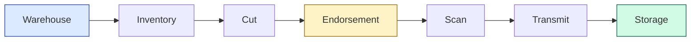

# iBookTrack — Documentation Index


> Welcome. This folder is the complete handover package for **iBookTrack** —
> a unified Warehouse Management System and Executive Dashboard built for
> Innodata's book-digitization pipeline.

---

## 📖 Read in this order

| # | Document | When to read it |
|---|----------|-----------------|
| 1 | **[PROJECT_OVERVIEW.md](./PROJECT_OVERVIEW.md)** | First. Architecture, env setup, the 8-stage pipeline, known loopholes. |
| 2 | **[BACKEND.md](./BACKEND.md)** | When you touch anything under `backend/`. Routes, services, DB schema, constraints. |
| 3 | **[FRONTEND.md](./FRONTEND.md)** | When you touch anything under `frontend/`. Pages, components, auth, styling. |
| 4 | **[MIGRATION_GUIDE.md](./MIGRATION_GUIDE.md)** | When moving to a new server, DB, or hosting provider. |

---

## 🗺️ At-a-glance



> [!NOTE]
> Every box flows left → right through these seven stages. Each stage has its
> own UI page in `frontend/app/` and is enforced by the `boxes_current_stage_check`
> constraint in Postgres.

---

## 🚀 Quick Start (TL;DR)

```powershell
# 1. Install dependencies
cd backend  && npm install
cd ../frontend && npm install

# 2. Copy .env.example to .env at the repo root, fill in Supabase keys

# 3. Run migrations 001..025 in the Supabase SQL Editor (in order)

# 4. Start both servers in separate terminals
cd backend  && npm run dev      # http://localhost:5000
cd frontend && npm run dev      # http://localhost:3000
```

Detailed steps → [PROJECT_OVERVIEW.md §4](./PROJECT_OVERVIEW.md#4-local-development--from-zero).

---

## 🔍 Quick links by topic

<table>
<tr>
  <th>I want to…</th><th>Go to</th>
</tr>
<tr>
  <td>Set up a new dev machine</td>
  <td><a href="./PROJECT_OVERVIEW.md#4-local-development--from-zero">Project Overview §4</a></td>
</tr>
<tr>
  <td>Understand the database schema</td>
  <td><a href="./BACKEND.md#database-schema">Backend §7</a></td>
</tr>
<tr>
  <td>Add a new API endpoint</td>
  <td><a href="./BACKEND.md#adding-a-new-route">Backend §12</a></td>
</tr>
<tr>
  <td>Add a new UI page</td>
  <td><a href="./FRONTEND.md#adding-a-new-page">Frontend §10</a></td>
</tr>
<tr>
  <td>Migrate to a new Supabase project</td>
  <td><a href="./MIGRATION_GUIDE.md#1-provision-the-new-database-supabase">Migration §1</a></td>
</tr>
<tr>
  <td>Promote a user to admin</td>
  <td><a href="./PROJECT_OVERVIEW.md#7-common-operational-tasks">Project Overview §7</a></td>
</tr>
<tr>
  <td>Add a new flag reason / pipeline stage</td>
  <td><a href="./MIGRATION_GUIDE.md#7-day-2-operations">Migration §7</a></td>
</tr>
<tr>
  <td>Resolve a stuck box</td>
  <td><a href="./PROJECT_OVERVIEW.md#7-common-operational-tasks">Project Overview §7</a></td>
</tr>
</table>

---

## ⚠️ Pre-Turnover Checklist

Open items at handover. Status badges:
🟢 done · 🟡 documented, action pending · 🔴 must-fix before production.

| Item | Status | Reference |
|------|--------|-----------|
| Hardcoded Simflex API key removed | 🟢 | moved to `.env` (`SIMFLEX_API_KEY`) |
| `SCANNING_INTEGRATION.md` (stale creds) | 🟢 | deleted |
| Dead code: `test-warehouse.js`, `routes/index.js`, `simflex-api.js` | 🟢 | deleted |
| `sampleNotifications` mock in sidebar | 🟢 | deleted |
| `.env.example` updated with all variables | 🟢 | committed |
| `.env` updated with `SIMFLEX_*` values on the dev machine | 🟡 | manual — user must copy live values |
| `frontend/app/Dashboard/` → `dashboard/` rename for Linux deploys | 🟡 | tracked in [Migration §3a](./MIGRATION_GUIDE.md#3a-vercel-recommended) |
| Production CORS lockdown | 🟡 | tracked in [Project Overview §6](./PROJECT_OVERVIEW.md#6-known-loopholes--cleanup-checklist-pre-turnover) |

---

## 🤝 Authors

OJT Interns 2025–2026 — handover authors:

- **John Rey Cutab**
- **Manwarul Francis Santos**

Built with Windsurf AI pair-programming.

> [!TIP]
> Each Markdown file in this folder renders nicely on GitHub, in VS Code's
> preview pane (`Ctrl+Shift+V`), and via tools like Obsidian. To export a
> single PDF: open the file in your browser via VS Code's "Markdown Preview
> Enhanced" extension, then `Ctrl+P → Save as PDF`.
